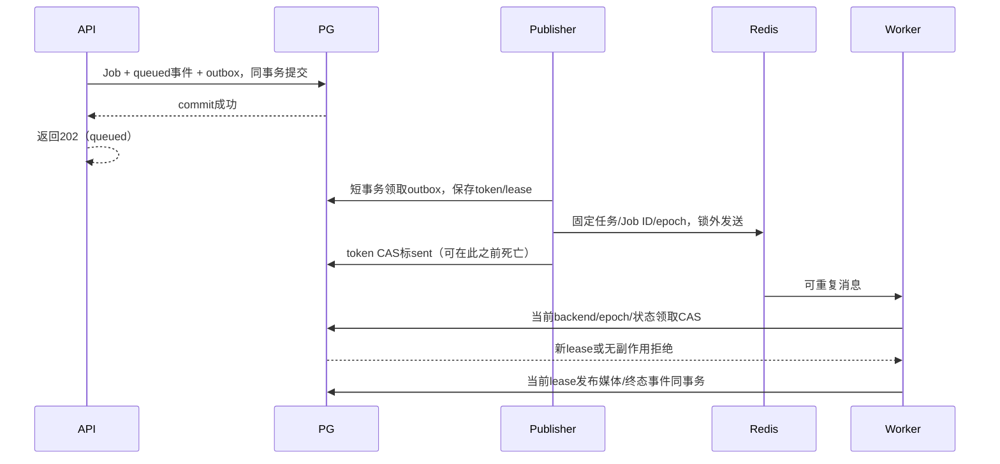

# ADR-0009：持久化动画队列、恢复与迁移

- 状态：**Accepted**（2026-10-04，用户批准 A–D）；不是已实施或阶段验收通过。
- 日期：2026-10-04；任务：PHASE-1-T018，实施 T019–T021，DSL 继承 T022/T027/T028。
- 依据：[PRD](../PRD.md) §0.1/§3.3/§5.7/§9.1、[Phase 1验收计划](../acceptance/phase-1-acceptance-plan.md)。
- 保留：[ADR-0004](0004-trusted-animation-jobs.md) 的 owner/幂等/租约/取消/媒体/SSE 与容器限制；[ADR-0007](0007-curated-course-catalog.md) 的目录资格；[ADR-0008](0008-provider-credentials-and-egress-boundary.md) 的凭据/临时Key/队列边界。

- 批准记录：本聊天用户明确回复“批准”，批准提案SHA256为 `215dd4aa313a9c2e953f869216694bf4cc72689a91ee075adf3da5fddaa7c2b9`；见[批准登记](0009-queue-approval-20261004.json)。

## 已核对的现状与本次范围

`models/animation.py` 已有 `animation_jobs`、`animation_job_events`、`animation_media`、owner 资源绑定及最多两次领取约束。`services/animation_jobs.py` 在一个 PostgreSQL 事务中保存预约/事件，缓存命中直接建立正式绑定。`animation_worker.py` 的独立轮询 Worker 使用30s租约、10s心跳、随机token、数据库时间与发布CAS；`animation_lifecycle.py` 提供取消和新Job显式重试。GET SSE读取PG事件，每轮检查2h会话；Redis/Celery尚未安装，compose仅有PostgreSQL/API/Web。运行器为 `backend/scripts/run_animation_worker.py`，部署手册要求另开宿主进程，不把服务函数存在等同于常驻进程已部署。

本提案只把**已审核、无需模型调用的动画渲染**可靠投递到Celery。讲解/代码/练习仍由API内流式生成，课堂不塞进长任务队列。后续模型DSL的生成/Review必须在获授权的Provider阶段完成，Worker只读取正式审核候选。PRD §5.7中的7d会话、LLM响应缓存和Redis热状态不是本阶段队列授权；不改变2h匿名会话、学习数据留存、目录门禁或真实模型预算。

## A. 唯一状态源、消息与凭据边界（推荐）

1. PostgreSQL继续独占业务Job状态、owner/已审核目标、幂等摘要、attempt、租约、取消、正式媒体引用和单调事件。Redis只是Celery broker，消息可重复、乱序、丢失或重送；Celery task ID/ACK/结果状态不能证明业务成功。禁用result backend，`task_ignore_result=True`；API/GET/SSE永不读取Celery AsyncResult。
2. 只注册固定任务 `edumind.render_animation.v1` 与固定队列 `edumind.animation.v1`。消息正文严格接受 `{schema_version: 1, job_id: UUID, dispatch_epoch: positive integer}`，拒绝额外字段/超限/非法类型；Celery task ID取对应outbox UUID用于追踪，不作为去重锁。只接受JSON序列化，禁止pickle、任意任务名、动态函数/命令、broker传入的路径/源代码/owner。
3. 消息只含内部标识，不含Cookie、session哈希、幂等键、Provider Key/密文/handle/连接凭据、画像/教材/对话、DSL正文、输出路径。Worker从PG校验job/owner外键、目标审核版本与渲染类型后获取受限输入，不能把消息的job_id当HTTP鉴权；用户读写仍从认证会话取owner。未知/终态/旧epoch消息无副作用ACK并记固定类别。
4. 渲染Worker不注入Provider环境/KEK，不允许模型出口；渲染容器禁网且没有DB/Redis/Docker socket/密钥。外层可信Worker控制器可启动受限Docker容器，但broker任务不能提供命令或扩大挂载。临时Key不跨进程；只有已经审核且不含凭据的DSL/Job ID可交给渲染，不能把尚待模型审核的阶段伪装成可恢复Job。
5. Redis专用实例/命名空间、私有连接及ACL，仅publisher/Worker可用；不向浏览器开放或公网绑定。使用持久卷/AOF及显式`maxmemory`上限/`noeviction`，满容量拒绝发布时仍保留PG outbox，不靠无限broker内存；恢复保证不依赖Redis零丢失。部署者安全注入broker凭据，连接串/密码/任务异常原文不输出。Celery事件与任务日志只记录安全ID/阶段/固定错误/计数，关闭原始输入trace；不能靠argsrepr掩盖真正敏感payload。

**为什么**：DB Job与消息系统无法共享一次原子提交。仅在commit后 `.delay()` 会丢失“API提交后进程死亡”的任务；把Redis状态当事实源破坏已有owner/SSE恢复。采用可重复消息和DB条件状态转换，不承诺执行恰好一次。

## B. 事务outbox与投递恢复（推荐）

1. Alembic增量添加Job内部字段 `dispatch_backend=pg_poll|celery`、`dispatch_epoch>=1`；为现有Job回填pg_poll/epoch1，现有状态、owner约束、两次attempt上限不变。添加 `animation_dispatch_outbox`：UUID、job外键、epoch、固定消息版本/任务类型、pending/sending/sent/obsolete状态、publisher token/30s lease、next_attempt_at、last_sent_at、transport_attempts与安全错误码。唯一键 `(job_id, dispatch_epoch)`。另加C4的受限尝试/容器清理账本；这些字段均不进入公共Job响应。
2. 新建或显式重试：认证/CSRF/owner/幂等/目标审核后，celery模式同一事务保存Job+queued事件+outbox，再commit；pg_poll模式只保存Job+事件，无可投递outbox。只有commit成功才返回202；broker不可用不撤销已接受celery Job。缓存命中为succeeded，不创建投递outbox。事务失败不产生Job/事件/消息。幂等重放直接返回原回执，不重复追加queued事件/outbox；异摘要继续409。
3. publisher每批最多100，用短事务 `FOR UPDATE SKIP LOCKED` 领取到期pending或publisher租约已过期条目，取得随机token；释放DB事务后才向broker发送，连接/发布一次尝试总timeout≤5s，禁无限Kombu内层重试。发送确认后按outbox token CAS置sent/last_sent_at；发送失败或结果未知保留可重投。每次传输失败退避1/2/4/…/60s（上限60s），不占业务render attempt，不伪装成Job failed。
4. “Redis已接收、publisher尚未标sent时死亡”必然可能重复发送；消息重复不改变Job幂等/attempt，靠C中的DB领取解决。Job取消或切换epoch会把旧outbox标obsolete；publisher可能已经在锁外发送旧消息，消费者仍以PG状态/epoch拒绝，不能把outbox终态当作网络原子撤回。
5. 独立reconciler每30s巡检。对celery/queued/未取消Job，若当前epoch的outbox缺失则补建；若sent后仍未被领取且last_sent_at已超过60s，则重新置pending；只重置已到期的publisher租约，不覆盖活跃publisher。这样Redis重启/flush/持久化丢失后可从PG重新投递，不能仅检查pending outbox。broker恢复且publisher/reconciler/Worker正常时，重新进入队列；不承诺停机期间完成或给无限故障定义成功时限。
6. 终态/取消/旧epoch条目只置obsolete，不复活Job；暂不新增Job/事件/outbox自动删除TTL。publisher传输次数可持续增加，但退避有界、每批有界；Job一直queued时用户仍可查看/取消，监控积压数量/最老等待时间/安全错误及恢复状态。不存在无声的“放弃已接受Job”。

跨表锁顺序固定为Job→outbox/尝试清理账本，事务内不做broker/Docker网络操作。publisher只锁outbox，若需Job资格仅作非锁定读取，不能持outbox锁再请求Job锁；取消、回收、迁移及reconciler先锁Job再处理附属行。旧资格读取允许多发一个消息，实际消费者仍以当前PG条件拒绝；不为避免多发引入锁反转。

### API成功响应与投递时序

## C. Worker租约、取消与正式发布（推荐）

1. 消费者按job_id取行锁，要求 `dispatch_backend=celery`、epoch匹配、queued、未取消且attempt<2；重新检查已审核目标资格。原子转running，attempt+1、随机lease_token、30s数据库租约和running事件同事务。两消费者只一个取得租约，活跃running/终态/旧epoch消息ACK但不执行、不增加attempt。pg_poll领取器必须显式过滤自己的backend。
2. Celery计划配置 `task_acks_late=True`、`task_reject_on_worker_lost=True`、prefetch multiplier1；禁业务autoretry/ETA链，重试由PG恢复器决定。ACK仅是运输行为，丢ACK/Worker child死亡也不能跳过DB条件。软/硬任务上限计划150/180s作为外层收尾保险；渲染容器仍为ADR-0004墙钟120s、CPU2/内存1GiB/pids128及256MiB配额，不能因队列延长渲染安全限制。执行器显式I/O超时；不能依赖Celery kill清掉外部容器。
3. 心跳仍每10s，使用数据库时间；持有者必须匹配running/epoch/attempt/token及未到期lease。DB失联或续租失败立即停止当前尝试容器并不发布；超时检查/停止失败固定告警，不能续用过期token。取消观察每1s且单次DB检查≤1s，保持ADR-0004取消后容器清理最多10s的要求；实现与实际容器故障演练须证明该总界限，不把逻辑取消响应当物理终止证据。
4. reaper每5s扫描过期running租约，最多100条短事务失效旧token。attempt<2且未取消则同事务改queued、epoch+1、recovered事件；celery补新outbox，pg_poll按兼容轮询恢复而不投递broker。否则failed/RENDER_INTERRUPTED及事件。领取时同事务写 `animation_job_attempts`（唯一job/attempt与唯一token、backend/epoch、launch_state、started_at、cleanup_requested_at/cleanup_done_at，容器名固定从token派生），在取消/回收/终止时同事务登记清理意图后才清Job token；旧token不能只保存在死Worker内存中。账本是清理证据而非第二Job状态源，不含输入/路径/凭据。消息重投不额外消耗attempt，只有新有效领取会消耗；自动恢复最多两次，用户明确重试仍新Job/retry_of/新幂等键。

   Docker启动/停止只能走同一可信宿主协调器：先在宿主锁外按Job→尝试账本短事务把prepared条件更新为starting并commit；然后取得token对应跨进程宿主互斥锁，非锁定读取确认有效PG lease、starting且无清理意图，再执行有界create/start。清理先在PG提交撤销/清理意图、释放PG行锁，再取相同宿主锁stop并检查不存在。所有launch_state写入均在宿主锁之外按Job→账本执行：Docker操作结束先释放宿主锁，再条件更新started/absent；迟到started不得覆盖cleanup_requested或新的epoch。宿主锁与PG显式行锁不交叉持有，不持PG行锁做Docker操作。清理意图登记在资格检查前则不能启动；检查后已获当前启动机会时取消由同宿主锁串行清理（不声称可撤回已发RPC）。持久launch_state记录prepared/starting/started/cleanup_requested/absent；异常退出不得丢失starting记录。

   “不存在”不是可永远忽略的终态：Docker RPC超时/启动确认丢失可能迟到，独立于Redis/Celery/Worker的宿主控制器每1s枚举本应用容器，按持久token账本核验当前lease，失效/被取消token即有界stop；即使cleanup_done_at已写，后来出现的容器仍重开清理意图。启动后的执行器也立即复核lease，失效即停止；Worker随后死亡时由控制器接管。正常退出和恢复启动都核实实际容器，未知旧容器按D处理，不凭任意前缀删除。禁止仅用“启动前读一次DB”或“当时不存在就done”处理检查后启动窗口；未确认清理按固定告警保留意图。该协议须在Docker/DB正常及RPC确认丢失两类演练中验证10s清理要求，故障不可确认时不报告清理成功。旧token在任何路径仍不能续租/正式发布。
5. 取消与媒体发布继续在同一Job行锁排序。取消先commit：cancelled、取消标志、失效token、取消事件及outbox obsolete同事务；任何迟到消息/完成/进度均拒绝。发布先commit：取消409 JOB_STATE_CONFLICT。Celery revoke只是可选唤醒，非状态/终止依据；broker掉线时取消照常由PG完成。
6. 读取正式候选时重查模板/DSL审核版本、课程发布/撤回、owner/场景资格；执行后媒体格式/摘要/字幕/参数一致性全部校验。发布事务内再次锁定并复核当前目标与发布/审核版本资格，运行期间被撤回即拒绝，不能只凭运行前检查。正式媒体引用、owner绑定、succeeded与终态事件只有当前未过期lease且仍具发布资格可同事务提交。内容地址不可覆盖、缓存版本/唯一约束、发布与GC协调锁及孤儿24h规则继承ADR-0004。重复可能重复计算，但不能重复正式绑定或让迟到结果取代现行版本；Redis结果不可成为媒体来源。

   发布锁顺序为Job→目标发布/审核资格行→缓存键协调锁→媒体/绑定；GC取缓存键协调锁后只做非锁定引用/有效发布意图读取，不反向获取Job或资格行锁，锁内再次确认才删无引用旧孤儿。测试必须覆盖GC与取消/发布/撤回并发，不能为队列迁移取消原GC保护。
7. 快照/GET SSE只读PG事务提交状态。保留queued/running/succeeded/failed/cancelled及recovered事件、Job内游标/Last-Event-ID/410快照恢复、owner隔离与逐轮会话核验。Celery receipt不是SSE事件，heartbeat不占事件序号；broker重投不新增业务事件。会话到期结束订阅，不改变后台无凭据渲染Job留存规则。

[Celery任务文档](https://docs.celeryq.dev/en/stable/userguide/tasks.html)说明幂等任务与late ACK，以及child死亡可能仍被ACK；[Redis broker文档](https://docs.celeryq.dev/en/stable/getting-started/backends-and-brokers/redis.html)说明visibility timeout导致重送。项目使用PG租约/状态抵御重复，不把这些选项宣称为恰好一次；visibility timeout计划300s并核对对应Celery配置，PG恢复器不等待它，禁用result backend。T019锁定支持Python3.11的具体Celery/redis-py/Kombu版本、锁文件和Redis镜像摘要，不以stable/latest URL作安装版本。

## D. 增量切换、回滚与验收（推荐）

1. T019先交付兼容版本：增量迁移、outbox、publisher/reconciler与新Job路由开关 `EDUMIND_ANIMATION_DISPATCH=pg_poll|celery`，迁移期默认pg_poll；修订旧领取器只处理pg_poll。T020交付Celery固定任务/租约/reaper，T021接入取消/SSE与新旧同语义。不能在未经过滤的旧二进制和新Celery之间混跑同一queued池。

本阶段保持单个可信渲染宿主、同一Docker daemon与API/Worker共享既有私有媒体目录，Celery可用多个执行进程；不新增跨宿主媒体分发/远程Docker控制。迁移前盘点在途租约/容器，给可核对的既有running token补建尝试账本，无法对应的旧容器须人工处置/排空后再切换，不自动删除未知容器；后续尝试全部由账本追踪。T036检查宿主控制器重启后仍能清理，不把Worker父进程死亡后的外部容器遗留忽略掉。
2. 小范围切换只在隔离测试环境启用celery，新Job存所选backend；历史running租约按原backend排空，不改写活跃lease。历史queued模板Job可由管理员批次行锁迁移：检查queued/未取消，backend=celery、epoch+1和新outbox同事务；旧pg_poll或旧epoch消息不再能领取。既有终态/媒体/事件不改写。旧缓存命中仍0队列渲染。
3. 回滚先把新Job开关设pg_poll、停止新迁移，暂停Celery消费者；等待活动lease完成或过期回收并停止其容器后，仅对queued模板Job批次改pg_poll/epoch+1并obsolete旧outbox。兼容PG领取器继续处理这些Job。临时并存可产生旧消息，但backend/epoch/token使其无副作用；不清空Redis作为正确性的前提，也不在代码回滚时破坏性downgrade已接受Job的数据。
4. 尚未审核或DSL型Job不能交给旧模板执行器。DSL功能实施后，回滚无法执行的queued DSL Job明确failed/RENDERER_UNAVAILABLE并保留候选与恢复证据；原终态不改写，恢复支持后由用户新Job显式重试。不得默默换模板、在旧Worker执行DSL或放宽AST/禁网。未经修改的Phase 0旧二进制只能在新字段对应所有活跃Job排空、无DSL活跃Job且Celery停用后运行；常规回滚使用本提案的兼容PG版本。
5. T036必须实际运行隔离PG/Redis/Celery Worker/渲染容器：API提交与发送前死亡、ACK前后死亡、重复/乱序/错误epoch、Redis重启与消息清空、发布ACK丢失、Worker父/子进程死亡、DB失联、租约过期/迟到结果、取消与发布两个顺序、运行中课程撤回、滚动切换/回滚/模板缓存。还须覆盖“领取后启动前取消，清理先确认不存在，旧Worker/RPC随后启动再死亡”，确认即使账本曾absent也会再次清理且无正式发布。保留新旧Job ID/事件/lease与媒体摘要，断言已接受Job不丢、只有一个正式owner绑定、最多两次领取且取消不可复活；对应模型出口为0。
6. T036/T038沿用Phase 1冻结的100槽模板与100槽SSE等分母，T037另验DSL与容器安全。设计/Mock不能代替真实Worker或媒体检查；T042退出须证明celery配置的真实恢复，不以长期保持pg_poll冒充队列交付。队列安装和切换不批准生产部署/动态入口/真实Provider预算。

## 失败情形核对表

| 情形 | 必须处置 | 主要验证 |
| --- | --- | --- |
| API事务rollback/commit后发送前死亡 | rollback无Job；commit后outbox可发现，202不依赖broker | T019/T036 |
| broker离线/发布timeout或ACK不明 | queued+outbox保留，1–60s退避，传输次数不消耗render attempt | T019/T036 |
| publisher已发送后死亡 | publisher lease回收，可重复发送；DB仅一次有效领取 | T019/T020/T036 |
| Redis重启/flush且outbox已sent | queued reconciler重新置pending，不仅扫描未发送记录 | T019/T036 |
| 重复消息/旧epoch/伪owner/额外secret | 固定消息schema拒绝；DB资格验证，无错误owner绑定/无渲染副作用 | T019/T020/T038 |
| Worker死亡/DB续租失败/硬限杀子进程 | 旧token失效、容器有界停止；PG reaper最多两次有效领取 | T020/T036 |
| 取消/完成竞争及Redis离线取消 | 共用PG行锁；先取消则迟到发布拒绝，先成功则409 | T021/T036 |
| 缓存同键/正式引用前崩溃/文件缺失 | 不覆盖不可变字节；owner单绑定/协调GC；缺失MEDIA_UNAVAILABLE | T020/T036/T037 |
| SSE断线/终态已读/会话过期 | PG游标与快照恢复；不重复生成，过期停止订阅 | T021/T038 |
| 新旧消费者并存/切换/回滚/DSL不兼容 | backend/epoch过滤；运行租约排空；不支持DSL明确失败 | T019–T021/T036 |
| 临时或持久Key/敏感上下文混进broker | 零凭据消息/日志/worker环境；模型阶段不进入渲染队列 | T019/T022/T038 |

## 批准与后续执行

用户已批准A–D整体方案，具体提案digest/原话已登记。批准解除T018及队列后续实施门禁，不代表功能/真实验证完成；T019–T021逐项实现并验证，T022 DSL新决定仍须具体批准。持续Phase 1授权继续有效，按优先级与文件顺序串行领取，不以持续授权代替后续安全/数据决定。

本次只核对代码事实、官方机制、状态矩阵、API兼容和迁移时序，未安装/运行Redis/Celery、未改生产/开发数据库、未调用Provider。具体验证记录写入根task.json/process.txt；后续实施需实际测试后才可声明保证成立。
