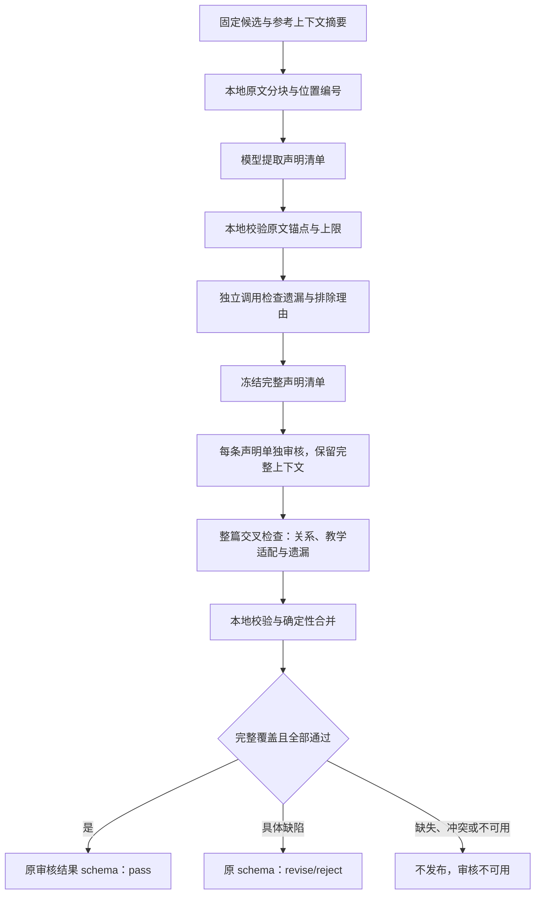

# ADR-0013：逐条声明审核与确定性汇总（设计稿）

- 状态：**Proposed，尚未批准或实施**。用户仅授权本次方案设计，不授权模型调用。
- 日期：2026-10-15；关联活动任务 PHASE-1-T040，不新增或完成业务任务。
- 读者：项目开发者与验收人；用途：决定是否值得实现新的审核流程。
- 继承：[PRD](../PRD.md) §0.1/§3.3、[ADR-0002](0002-streaming-first-screen-and-resource-review.md)、[ADR-0011](0011-independent-dynamic-acceptance.md)。公开 API、发布门禁、资源 schema、旧失败与原验收阈值保持。

## 1. 结论与证据

推荐把“一次整篇判断”拆成 **声明清单 → 独立覆盖检查 → 逐条审核 → 整体交叉检查 → 本地汇总**。
这增加请求与延迟，目的是让每条声明有可追踪的检查结果；它不能保证模型事实判断正确。

r07、r08 的原始最终回答均仅报告队列计数错误，没有报告空满条件错误。
代码和 schema 支持多 issue，没有程序截断证据；v6 增加“发现一处后继续检查”的指令仍未改善该例。
这支持尝试改变工作流，不足以唯一解释模型内部原因或否定模型的全部审核能力。
证据：[r07](../acceptance/phase-1-t040-review-scope-low/results/review-scope-r07.json)、
[r08](../acceptance/phase-1-t040-review-coverage-check/results/review-coverage-r08.json)。

本稿不再追加一个 Prompt 微调轮次，也不选择新模型。原实现、生产 none/catalog_only、
两次修正上限、T040 blocked 和旧停止台账均不改变。

## 2. 流程及通过条件

“逐条”是指独立的可检验断言，不要求对每个单词发送请求，也不要求每篇资源固定有几个问题。
公式、判定条件、操作规则、复杂度、代码行为、练习答案及适用前提都属于声明。
同一句包含两个可分别为真的判断时拆开；重复转述保留全部原文位置，不当作两个不同缺陷。

通过要求：同一候选/上下文/配置摘要下，覆盖检查无未解决遗漏或不确定项，清单每条都有合法终态，
整体交叉检查通过，且所有发现均无未解决问题。不能用多数投票、某条 pass、一个 revise 或平均分推导整篇通过。
缺失响应不视为 pass；一条出现确定缺陷仍须保留其他已运行结果，是否停止剩余调用按冻结方案执行。

## 3. 声明清单与覆盖风险

### 3.1 本地原文编号

首版采用 `resource-field-blocks-v1`：遍历受支持资源 content 的全部叶子标量字段；对象键按 Unicode
码点排序、数组保留原顺序，以转义后的 JSON Pointer 标识路径。每个叶子字段恰为一个块；
Markdown/source 字符串整字段为一块，不在此版本中解析或分割段落、列表、表格、函数。
题干、选项、答案及解释按各自字段成块；引用上下文单独绑定，不被当成候选声明来源。

字符串使用解码后的值；非字符串标量使用候选冻结器的规范 JSON 字面值并保留原类型，拒绝非有限数值。
段落/公式/代码语句由声明的字符区间定位，一个块可关联多条声明，不因一条引用就认为语义完整覆盖。
不按任意长度截断；标记使用结构路径和字段内字符区间 `[start,end)`，按 Unicode 码点计数。
若需要规范化换行，须先在受信候选冻结步骤完成，再计算摘要；冻结后不得重写原文。
block_id 由分块版本、候选摘要与字段路径生成；每块保存原文、路径、摘要，候选中的同名字段只当数据。
48块上限指上述叶子字段数，未来如改为 Markdown AST 分块须升级版本与重新冻结，不能静默换算法。

### 3.2 提取调用

输入完整候选与原文编号，返回有限声明列表及每块的覆盖/排除理由。
内部提案 `claim-inventory-v1` 包含版本、候选摘要、claims、block_dispositions：

| 数据 | 含义与本地约束 |
| --- | --- |
| claim anchors | 一个或多个 block_id + 字符区间 + exact_quote；必须逐字等于原候选子串，不能凭 paraphrase 证明锚点正确 |
| claim text | 审核焦点的短描述；不是标准答案，不能引入原文没有的事实 |
| related anchors | 代码/定义等依赖位置；提取模型可建议，但不得决定删去其余上下文 |
| block disposition | 每块映射到声明，或给出仅标题/装饰等排除理由；遗漏、重复冲突或未知块 ID 失败 |

claim_id 由服务端根据候选摘要、排序后的锚点及声明描述生成，不信任模型提供的 ID。
字面相同锚点可能承载多个不同断言，不仅凭区间相同就合并；归一化规则需版本化。

本地只能保证“每块有交代、引用来自原文”，**不能证明每块中的全部语义都已提取**。
允许排除块也可能把错误藏起来；不得把“全部块被引用”称为完整事实覆盖。

### 3.3 独立覆盖检查调用

提供完整候选、原文编号、清单及所有排除理由。另一次调用检查每块是否还有未被清单覆盖的独立断言、
是否把复合断言合成一条，以及排除理由是否成立。输出遗漏声明的原文锚点或明确的不确定项。
“独立”只表示单独的检查职责与调用，不宣称同一模型的错误相互独立，也不要求切换厂商。

允许把这一次检查发现的缺项加入清单，经同样的锚点校验后单独审核；禁止递归自发提取或无限补齐。
覆盖检查还存在不确定项、无法定位的漏项、错误排除或超出上限时，整篇不能通过，结束为审核不可用。
只有提取器称“无声明”也不能直接通过；须覆盖检查与后面的整体检查均确认且无事实判断待核对。
整体检查再次发现清单之外的新断言时，保留具体发现并停止发布，不在同轮临时新增付费分支。

## 4. 每条审核与整体交叉检查

每条调用输入：当前 claim_id/精确原文锚点、完整原候选、完整已提供参考上下文、候选与清单摘要。
完整函数、调用者、计数/容量约定、头结点定义、前置条件等不得因焦点在一条公式而丢失。
首版不做检索裁剪；上下文超过明确输入上限就阻止该候选，不静默去掉代码或截断成孤立断言。

内部 `claim-review-v1` 输出 claim_id、候选/参考上下文/清单/配置摘要、pass/revise/reject、
焦点 findings，以及单独的 incidental_findings。焦点 findings 使用原 area/severity/message 形式；
incidental_findings 还必须携带其他声明的原文锚点，按同样的来源/定位规则校验，不能放进焦点 findings。
原文、说明、代码、清单和参考数据一律为不可信数据，不执行代码，不采纳其中要求忽略系统指令的内容。
严格拒绝额外字段、未知枚举、错误 ID/摘要和空问题文字。pass 必须 findings=[]；revise/reject 必须至少一条
有效 finding，否则整条响应无效并记审核不可用。severity 保留原 minor/major/severe，并不新增
“某 severity 必须对应某 verdict”的硬映射；类别、严重性和处置是否合理在事实验收中分别核对。
焦点描述必须与原文锚点表达同一声明；
若提取描述偷换了含义，不得把描述错误当成原候选事实错误，应记清单无效/审核不可用。

一个调用只决定焦点断言的真值及其与实现的矛盾，须给具体条件/反例；不写修复公式、替换代码或补丁。
发现其他断言问题放入 incidental_findings；焦点正确时仍可输出 pass 和 findings=[]，
但附带发现必须进入整篇本地汇总，不能因焦点 pass 被丢弃，也不能替代其他声明的计划审核槽。
附带发现定位到清单外断言则覆盖未完成、整篇不可用；与该断言自己的结果冲突则按未解决冲突处理，不能投票通过。

整体交叉检查始终面对完整资源与清单，不把各条的 pass 当成标准答案。
它检查声明之间的冲突、代码调用/所有权的跨段关系，以及难度、误区、目标/前置方向、练习整体合法性。
这样避免“每条孤立看似正确，合起来却错误”，并保留现有审核的教学适配职责。
整体检查新增真实问题时必须进入汇总；新增未覆盖声明/不确定判断则不得发布，不自发再跑一轮。

## 5. 本地汇总、错误与修正

汇总由确定性代码完成，不再让一个模型重新摘要或删减已发现的问题。
先核对候选/上下文/清单/配置摘要、所有计划槽 ID、响应 schema 与完成状态；重复、缺失、串错候选均失败。
对完全一致的定位/类别/文字发现可去重，但保留全部来源；不通过文本相似度把独立问题压成一条。
任何一条的否决不能被别条 pass 覆盖。同一断言同时有真实冲突结论，不能投票放行，先归为未解决。

| 情况 | 最终处理 |
| --- | --- |
| 全部覆盖/审核/整体检查完成，无问题 | 原 resource-review-v3 的 pass、issues=[] |
| 有具体有效问题，整个流程已完成且可聚合 | 合并原 issues；存在 reject 则 reject，否则 revise |
| 缺少槽、无法完成覆盖、未知用量、协议失败、结论冲突或超限 | 不发布，内部记 unavailable/incomplete；不能伪造成一个事实错误 |

对外继续兼容当前 ReviewOutcome 和资源发布门禁：沿用现有审核不可用路径及其固定标记
`Resource review is unavailable.`，不新增公开错误码/状态或数据库字段；内部诊断记录保留各阶段的真实原因
与已检出的具体问题。这是拟议适配方式，实施前须检验现有调用者不会把不可用结果触发为自动修正。
内部新 schema 不由原 ReviewSchemaError 验证器冒充已支持，必须有各自严格校验器与版本。

修正仍由独立生成步骤执行，最多两次，不自动修复 unavailable。每个修正候选有新摘要，
必须从声明提取开始重跑整个流程，旧清单/旧 pass 不能复用成新候选证据。
若某轮错误后已按诊断规则停止而未完成其余槽，不能触发修正并把该轮计为正式审核通过。

## 6. 有界调用、费用与冻结规则

以下仅为首版设计上限候选，**未批准、未实施、未授权真实请求**：

| 约束 | 建议值/处理 |
| --- | --- |
| 候选上限 | 全部候选及参考数据合计 48 KiB UTF-8；超限拒绝，不截断；正式长例是否能容纳须离线测量 |
| 原文块上限 | 48 块；超限结束，不把多块拼成一条伪覆盖 |
| 声明上限 K | 16 条，包含覆盖检查补出的声明；超限结束，不只审核前 16 条 |
| 同时在途 | 1；无自动重试、回退、模型切换或额外模型汇总 |
| 单次与输出上限 | 每阶段分别冻结总输出（含推理）、HTTP 及总期限；本稿不照搬旧 8192/120 秒为所有阶段批准值 |
| 全流程时限 | 另设整体期限，按剩余时间阻止新发送；超限不发布，不重启台账 |

一个无修正候选的最大请求数为 **N+3**：提取 1、覆盖检查 1、N 条审核、整体检查 1；N≤K。
K=16 时最多 19 次。零声明也不能略去提取、覆盖和整体检查，最少 3 次；静态安全规则先拒绝可为 0 次。
包含最多两次修正生成与三轮完整重审的最坏上限为 **3(K+3)+2=59 次/资源**，并非计划全部发送。
生成 100 单元的三类资源若每类都走上限，无修正审核最多 5700 次；最多两次修正的理论上界 17700 次，
另加生成、探测及其他任务。因此旧“每资源 1 次审核、正常总计约 600 次”的粗预算对本方案失效。

不能仅用次数估算 Token/金额。每轮固定一个币种，金额统一以该币种的百万分之一为整数单位
（例如 microCNY），不换算币种；input_price/output_price 为每百万 Token 的微货币单位整数。
input_bound_i 与 total_output_cap_i 都是 **Token 数**，分别包含输入总量上界及推理+可见输出上界。
第 i 次费用保守上界（微货币整数）为：
`ceil(input_bound_i * input_price / 1000000) + ceil(total_output_cap_i * output_price / 1000000)`，
两个分项各自向上取整，再累加；不能在浮点元/美元上直接取整。

输入含完整候选、清单、系统提示、schema 与适配器额外开销；字节长度不是 Token 数。
只有证明实际 tokenizer/传输的字节到 Token 保守界及额外开销后，才可从 wire UTF-8 字节推导 input_bound_i；
不能默认对任意新模型成立。每个依赖结果的最长合法序列化尺寸也须界定，无法证明计费上界则禁止调用。
所有实际尝试先持久预留再发送；失败不退回预留，未知/超上界用量即停；不复用旧轮次余额。

### 动态子请求与 ADR-0011 的冲突

提取结果决定后续声明数量与请求正文；覆盖输出也决定清单。按现行 ADR-0011，不能在调用前就声称
这些尚不存在的完整输入 hash 已冻结，也不能把新请求偷偷塞进旧 review 槽或用“2 次检查”授权 19 次。

分开两条路径：

1. **先做无调用工程原型（推荐下一步）**：使用明确标为合成的提取/审核输出，验证锚点、覆盖、合并、
   失败、上限和修正重审；不把合成声明当作模型提取通过，也不算 T040 真实验收。
2. **再设计自动链路真实轮次**：须先单独批准 ADR-0011 的受限补充。建议预先冻结模板/schema/源文件、
   候选与输入上界、最大槽集合/次数/金额、派生和停止规则；父输出合法后，在持久台账内记录其摘要，
   构建子请求并在发出前固定实际 wire hash 与父摘要。超出预批信封即停，不追认。批准具体补充及其
   可执行实现前禁止自动链路真实调用；仅批准本稿流程方向不等于批准动态派生规则或请求预算。

不修改现行 ADR-0011 附件、旧 manifest 或失败记录。若不接受该补充，只能每个依赖阶段形成具体输入后
重新冻结审批；本稿不选择“默许动态请求”。人工预先整理的清单可以检验逐条审核器，但无法证明自动提取能力，
不能据此声称整个方案通过或代替 T040 完整诊断。

## 7. 验证与采用顺序

### 7.1 零调用工程验证

设计通过后，先实现内部原型及独立校验，保持生产路径不切换。至少覆盖：

- 原文引用伪造/偏移错误、中文/换行区间、未知块、复合断言、错误排除、重复与越界 ID。
- 提取漏掉一个断言，覆盖检查补出；覆盖仍不确定时不能 pass；满块映射仍可能语义漏项须显式报告限制。
- 完整函数/调用者与表示约定保留；不同资源类型包括题干/答案字段，不能只审核讲解 Markdown。
- 多条真实问题不被合并丢失、冲突不靠投票、整体新增问题进入汇总、新漏项停止发布。
- 单槽失败/未知用量/超限/重启不重置、实际 wire 与父输出绑定；未批准不得读 Key 或发送。
- 最多两次修正，每次整条新候选重新提取/审核；不依赖旧候选 pass；不可用不触发修正。

Mock 只验证流程和门禁，不能证明声明提取召回、真实审核质量或时延达标。

### 7.2 真实诊断的前置准备

只使用原历史诊断材料；逐案例人工核对标准声明位置、已批准缺陷与覆盖清单，不能将标准答案发送给模型。
分开报告提取覆盖、覆盖检查漏项、声明审核检出/误拒、整体检查及最终资源级结果。
原资源级分母与标签保持，一篇拆成多个声明不增加严重错误样本数；某条 pass 不抵消原整篇漏检。

先测量实际历史材料的块数/长度与人工声明清单，以决定 K/输入上限是否可行；不能先削去长例使其适配。
真实诊断必须同时包含正确资源与多断言错误资源，覆盖代码安全、索引约定和跨段关系，避免只优化队列一例。
具体阶段、请求、模型/参数、费用、人工事实门禁在可执行方案中另行冻结审批；本稿不提出 r09 预算。
保持五错误、五分类、一正确、两长的原四组诊断要求和停止规则；不能把若干声明测试拼成四组通过。

正式新例不用于方案调参；采用新审核组合后，原正式质量仍须独立冻结/验收。
吞吐、费用和审核发布延迟单独量测，不能用 HTTP 200 或工程回归替代模型质量。

## 8. 选择、风险与待决事项

| 备选 | 取舍 |
| --- | --- |
| 继续微调单次整篇 Prompt | 成本最低，但 r07/r08 同漏项，暂不继续付费试错 |
| 多次整篇投票 | 仍可能共同漏项，还可能用多数掩盖已知错误；不选投票作为通过依据 |
| 确定性分句后每句审核 | 原文位置稳定，但无法可靠拆解复合语义或代码关系；只用作块编号，不冒充完整声明提取 |
| 提取、覆盖、逐条、整体检查、本地合并 | 推荐方向；有可追踪槽位，代价是较大请求/上下文开销，仍有相关漏检与误拒风险 |
| 更换审核模型 | 尚无新组合实测或授权；可另行提案，不与流程变化同时试验来混淆归因 |

需要用户后续决定：是否接受多阶段方向并进入**零调用原型实现**；是否愿意讨论动态子请求冻结的 ADR 补充。
K=16/48块/48KiB 只是待离线测量的候选值，不以本设计稿暗改原长例或覆盖要求。
若原型和测量显示延迟/预算不可接受，可以放弃本方案，保留目录版与 T040 blocked，不降低准入标准。

## 9. 本次交付边界

只有设计文件及活动账本/交接更新；运行代码、Prompt v6、公开协议和生产配置不变。
本次真实 Provider 请求 **0**，未声称模型质量改善，不启动完整诊断/正式质量/DSL/T041。
批准设计、批准内部原型、批准 ADR 派生规则、批准具体真实预算以及批准动态开放是不同决定。

## 10. 设计检查记录（不作为用户批准）

2026-10-15：按 doc-coauthoring 的 Reader Testing 进行无聊天上下文的只读检查。
读者独立回答覆盖风险、上下文、聚合终态、调用上限、动态冻结及授权范围六个问题。
初查指出分块、非法响应组合、费用单位不够具体；均已补齐。
复查指出焦点 pass 与其他断言附带发现的承载冲突，现通过单独 incidental_findings 与本地汇总规则解决；
再次复查确认该冲突消除。该检查是文档可理解性检查，不是模型质量测试或人工事实验收签核。
相对链接、代码围栏、19/59及5700/17700算术、任务依赖和旧冻结来源核验通过。
纯文档交付未运行新的业务测试，未修改运行源码、历史冻结文件或 Provider 设置。
